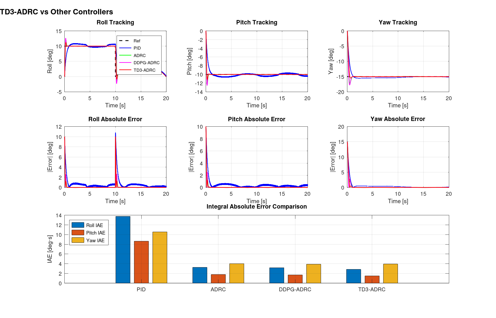

# TD3-ADRC: Intelligent Control for Quadrotors

Twin Delayed Deep Deterministic Policy Gradient + Active Disturbance Rejection Control for quadrotor UAVs.



*Output of `demo_comparison`: attitude tracking, absolute error and IAE for four controllers.*

## Overview

This project implements the **TD3-ADRC** intelligent controller based on "Intelligent Control for Quadrotors Based on a Novel Method: TD3-ADRC" (Cai et al., 2026). The method combines deep reinforcement learning (TD3) with enhanced ADRC using a parameterized tanh function for superior disturbance rejection.

**Key idea** (the paper reports a **37.28% improvement** over traditional ADRC):
- Twin Q-networks (mitigate overestimation)
- Delayed policy updates (training stability)
- Novel parameterized tanh function (smooth, continuous nonlinearity)
- Online ADRC parameter adaptation via learned policy

## Features

- 12-state nonlinear quadrotor dynamics model
- Enhanced ADRC with parameterized tanh function
- TD3 deep reinforcement learning for parameter optimization
- MATLAB simulation environment
- Blender 3D visualization pipeline
- MCP integration for interactive control

## Quick Start

```matlab
% Setup paths
setup_paths;

% Run comparison demo
demo_comparison;
```

## Project Structure

```
TD3-ADRC/
├── params/           % Configuration parameters
├── src/
│   ├── dynamics/     % Quadrotor dynamics model
│   ├── control/
│   │   ├── adrc/     % ADRC components
│   │   └── td3_adrc/ % TD3 + ADRC integration
│   ├── estimation/   % Disturbance observers
│   ├── visualization/% Plotting and export
│   └── mcp_tools/    % MCP server integration
├── demos/            % Demonstration scripts
├── tests/            % Unit tests
├── results/          % Output figures and animations
└── blender/          % 3D visualization assets
```

## Use Cases

### 1. Wind Gust Disturbance Rejection
Quadrotor maintaining hover under time-varying wind disturbances.

### 2. Aggressive Maneuver Tracking
Track sinusoidal + step attitude commands with rapid transitions.

### 3. PX4 Hardware-in-the-Loop
Validated in the paper on a 3-DOF test bench with a PX4 flight controller; not implemented in this repository.

## Performance Results

Simulation in this repository (`demo_comparison`, step + sinusoidal attitude commands, 20 s, IAE in deg·s):

| Controller | Roll IAE | Pitch IAE | Yaw IAE | vs ADRC |
|------------|----------|-----------|---------|---------|
| PID        | 13.75    | 8.64      | 10.54   | –       |
| ADRC       | 3.25     | 1.78      | 4.01    | baseline |
| DDPG-ADRC  | 3.17     | 1.69      | 3.90    | +3.1%   |
| **TD3-ADRC** | **2.83** | **1.50** | **3.93** | **+8.6%** |

The TD3-ADRC parameters here are not from a fully trained agent, so the gain is smaller than in the paper. Results reported by Cai et al. on hardware:

| Controller | Roll IAE | Pitch IAE | Yaw IAE | Improvement |
|------------|----------|-----------|---------|-------------|
| PID        | 80.27    | 70.13     | 93.48   | baseline    |
| ADRC       | 138.08   | 81.75     | 98.42   | -           |
| DDPG-ADRC  | 85.34    | 59.27     | 67.68   | +22%        |
| **TD3-ADRC** | **33.50** | **38.43** | **51.68** | **+37%** |

## Requirements

- MATLAB R2023b or later
- Deep Learning Toolbox
- Reinforcement Learning Toolbox
- Simulink (optional)
- Blender 3.6+ (for visualization)

## References

Cai et al. (2026). "Intelligent Control for Quadrotors Based on a Novel Method: TD3-ADRC"

## License

MIT License - See LICENSE file for details.
